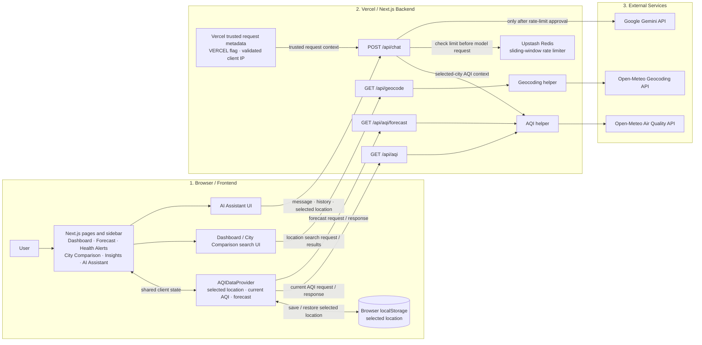

# SmogShield AI

SmogShield AI is an air-quality dashboard for Indian locations. It brings together model-based current AQI estimates, a five-day forecast, location comparisons, general health guidance, and a Gemini-powered air-quality assistant.

## The problem

Air pollution varies by place and time, and an AQI number can be difficult to act on without context. SmogShield AI helps residents, commuters, and people planning outdoor activities explore air-quality estimates and understand general precautions. It is an informational tool, not an official monitoring service or a substitute for public-health advice.

## Features

- **AQI Dashboard** — Search for Indian cities, towns, and districts; view current US AQI, available pollutant readings, and forecast information for the selected location.
- **Five-day Forecast** — Explore the returned five-day US AQI forecast and available PM2.5/PM10 values, with daily summaries and forecast-based guidance.
- **Health Alerts** — View general precautions based on a valid, location-matched, non-demo current AQI reading. Demo data does not generate health alerts.
- **City Comparison** — Compare the selected city with another Indian city using current, non-demo AQI readings.
- **Insights** — Review forecast summaries such as trend, cleaner and more polluted days, and forecast peaks. These are calculated from the returned forecast points.
- **Gemini AI Assistant** — Ask air-quality questions. The assistant can use the selected location and current AQI context when available, and can answer general questions when current data is unavailable.

## Technology

- Next.js 16 App Router, React 19, and TypeScript
- Tailwind CSS 4
- Open-Meteo Geocoding API for Indian location search
- Open-Meteo Air Quality API for current values and forecasts
- Google Gemini via `@google/genai`
- Upstash Redis and `@upstash/ratelimit` for chat rate limiting
- Vitest for tests and ESLint for linting

## Architecture and data flow

1. The dashboard searches locations through the application's `/api/geocode` route. The route calls Open-Meteo geocoding and returns Indian results.
2. The shared `AQIDataProvider` requests current AQI and forecast data through the application's API routes. It shares the selected location across pages and saves that selection in browser local storage.
3. The server-side AQI routes call Open-Meteo with the selected coordinates and timezone. They return provider readings and forecasts to the browser; requests without a selected location use Kolkata as the default.
4. The dashboard pages present the returned data and calculate summaries such as daily averages, forecast trends, and city comparisons in the application.
5. The assistant sends the question, conversation history, and selected location to `/api/chat`. The server retrieves current AQI context when available and sends the request to Gemini. Gemini and Upstash credentials remain server-side.



## API

| Method and route | Purpose |
| --- | --- |
| `GET /api/aqi` | Returns current US AQI and available pollutant readings. Without location parameters it uses Kolkata. To request another location, supply `latitude`, `longitude`, `locationName`, and `timezone` together; `region` and `country` are optional. Coordinates are restricted to approximate India bounds. |
| `GET /api/aqi/forecast` | Returns the five-day forecast for Kolkata by default, or for a location supplied with the same required location parameters. The response includes US AQI and available PM2.5/PM10 forecast values. |
| `GET /api/geocode?q={query}` | Searches Indian locations. The query must contain 2–100 characters; up to 10 results are returned. |
| `POST /api/chat` | Sends an air-quality question to Gemini. The JSON body accepts `message`, optional `history`, and an optional selected `location`. Chat requires server credentials and a trusted Vercel client IP for rate limiting. |

These routes return JSON. Invalid inputs return a 400 response; upstream failures can return 502. Chat can also return 429 when rate limited or 503 when required configuration or trusted client metadata is unavailable.

## AQI data and limitations

SmogShield AI requests the **US AQI** (`us_aqi`) and pollutant fields from the Open-Meteo Air Quality API. These values are model-based estimates, **not verified ground-station measurements or CPCB station readings**, and should not be treated as guaranteed real-time observations. The displayed source timestamp is the timestamp supplied by the API, not evidence of a local sensor measurement.

Open-Meteo documents its air-quality forecasts as based on CAMS European and CAMS Global forecast data. The application does not set the API's `domains` parameter, so it does not pin a specific domain or model; Open-Meteo's automatic domain selection applies. The selected domain's spatial resolution, time steps, and update cycle limit the detail and freshness of results. Forecasts are estimates that can change and may differ from measured conditions. Use official local monitoring and public-health advisories when making decisions.

Health alerts and recommendations are general information based on AQI categories. They are not personalized medical advice, diagnosis, or treatment guidance. Follow local public-health advice and consult a qualified healthcare professional about personal health concerns.

For provider details, see the [Open-Meteo Air Quality API documentation](https://open-meteo.com/en/docs/air-quality-api).

## AI assistant limitations and rate limiting

Gemini responses are generated and can be incomplete or incorrect. The assistant is intended for general air-quality information, not diagnosis or personalized medical advice. It is instructed to use the current request's location and AQI context when available, avoid inventing current readings, and state when data is unavailable; these safeguards do not guarantee that every generated answer will be accurate.

Chat uses a server-side Gemini API key and Upstash Redis credentials. The route allows **10 requests per client IP per minute** using Upstash's sliding-window limiter. It only accepts a client IP when running on Vercel (`VERCEL=1`) and can validate the Vercel-provided `x-forwarded-for` address. Ordinary `npm run dev` does not provide this trusted Vercel request metadata, so chat returns HTTP 503 locally even when the API keys are configured. Do not work around this by supplying an arbitrary forwarding header. The AQI and geocoding features do not require these chat credentials.

## Local setup

### Prerequisites

- Node.js 20.9.0 or later
- npm

### Install and run

```bash
npm install
```

Copy the example environment file if you want to configure chat:

```bash
# macOS/Linux
cp .env.example .env.local
```

```powershell
# Windows PowerShell
Copy-Item .env.example .env.local
```

Edit `.env.local` locally and replace the placeholders with your own credentials. Do not commit this file. Current AQI, forecasts, and location search can be used without the chat credentials; ordinary local chat remains unavailable because trusted Vercel request metadata is required.

Start the development server:

```bash
npm run dev
```

Open [http://localhost:3000](http://localhost:3000). Run the tests, lint, and production build with:

```bash
npm test
npm run lint
npm run build
```

## Environment variables

These variables are used by the server-side chat route only. Keep them out of source control and do not prefix them with `NEXT_PUBLIC_`.

| Variable | Purpose | Placeholder example |
| --- | --- | --- |
| `GEMINI_API_KEY` | Authenticates server-side requests to Gemini. | `your_gemini_api_key` |
| `UPSTASH_REDIS_REST_URL` | Upstash Redis REST endpoint used by the chat rate limiter. | `https://your-upstash-rest-url` |
| `UPSTASH_REDIS_REST_TOKEN` | Upstash Redis REST authentication token. | `your_upstash_rest_token` |

The checked-in [`.env.example`](./.env.example) contains placeholders only. `VERCEL` is a Vercel-provided system environment variable used by the chat route; do not set it manually to bypass the trusted-IP check.

## Deploy to Vercel

1. Import the repository into Vercel and use the detected Next.js framework settings.
2. In the Vercel project's environment-variable settings, add `GEMINI_API_KEY`, `UPSTASH_REDIS_REST_URL`, and `UPSTASH_REDIS_REST_TOKEN` for each environment where chat should be available. Keep these server-only.
3. Enable Vercel system environment variables so the chat route can verify `VERCEL=1` and use the trusted client IP supplied by Vercel.
4. Deploy the project. Vercel runs the Next.js build; after deployment, open the assigned URL and follow the walkthrough below.

AQI and geocoding use Open-Meteo and do not need the chat credentials. Chat remains unavailable if its credentials, Upstash rate-limit service, or trusted Vercel client metadata are unavailable.

## Evaluator walkthrough

1. **Dashboard** (`/dashboard`): Start with the default Kolkata view or search for an Indian location. Review the current AQI, available pollutant data, and forecast summary.
2. **Five-day Forecast** (`/forecast`): Inspect the forecast chart, daily summaries, and forecast-based insights for the selected location.
3. **Health Alerts** (`/health-alerts`): Review the category-based precautions. Alerts require a valid, location-matched, non-demo current reading.
4. **City Comparison** (`/compare`): Search for a second Indian city and compare its current AQI with the selected city.
5. **Insights** (`/insights`): Review the calculated forecast trend, cleaner and more polluted days, and the forecast peak.
6. **Gemini AI Assistant** (`/assistant`): Ask a general AQI question or ask about the selected location. Use a Vercel deployment with the required environment variables; chat is expected to return 503 under ordinary local `npm run dev`.
